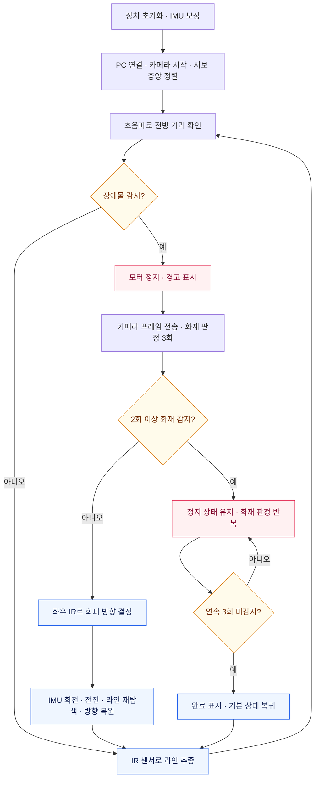
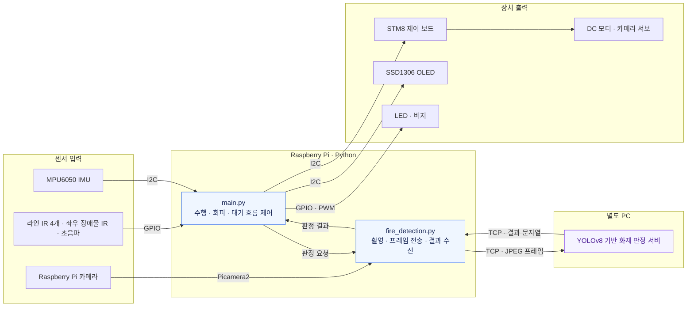

<div align="center">

# 🚗 삐송삐송

### 화재 탐지 기반 장애물 회피 자율주행 로봇카

**검은 선을 따라 움직이고, 장애물을 구분해 다음 행동을 결정합니다.**


[프로젝트 소개](#overview) · [시연 영상](#demo) · [주요 기능](#features) · [동작 방식](#workflow) · [아키텍처](#architecture) · [팀 소개](#team) · [실행 방법](#getting-started)

</div>

---

<a id="overview"></a>

## 프로젝트 소개

**삐송삐송**은 라인트래킹, 장애물 회피, 카메라 기반 화재 판정을 하나의 주행 흐름으로 연결한 라즈베리파이 로봇카입니다. 센서 입력을 읽는 데서 끝내지 않고, 판정 결과를 모터 제어와 상태 표시로 이어지게 만드는 것을 목표로 제작했습니다.

라즈베리파이는 센서 입력과 장치 제어를 맡고, 별도 PC는 카메라 영상의 화재 판정을 맡습니다. 일반 장애물을 만나면 우회해 라인으로 복귀하고, 화재로 판정된 대상 앞에서는 정지한 채 감지 상태를 확인합니다.

| 항목 | 내용 |
|---|---|
| 프로젝트명 | **삐송삐송** |
| 개발 기간 | **2025.10.16 ~ 2025.12.04** |
| 진행 배경 | 2025년 2학기 센서프로그래밍 수업 |
| 팀 구성 | 송채강, 이세진, 이수민 / **3인** |
| 형태 | 센서와 액추에이터를 직접 연결한 라인트래킹 로봇카 |
| 핵심 기술 | Python, Raspberry Pi, GPIO, I2C, OpenCV, TCP Socket |
| AI 연동 | 별도 PC의 YOLOv8 기반 화재 판정 |
| 확인된 시연 | **불 이미지가 있는 대상 앞에서 정지** |

<a id="demo"></a>

## 시연 영상

<div align="center">

**🎬 삐송삐송 실제 동작 영상**

_시연 영상 업로드 예정_

<!-- DEMO_VIDEO_START -->
<!-- 실제 영상을 업로드한 뒤, 이 위치에 GitHub 업로드 URL이나 영상 링크를 넣으세요. -->
<!-- DEMO_VIDEO_END -->

</div>

> 시연에는 실제 불꽃 대신 **불 이미지**를 사용했습니다.

<a id="features"></a>

## 주요 기능

| 기능 | 동작 | 주요 코드 |
|---|---|---|
| **라인트래킹** | IR 센서 4개의 감지 조합으로 직진과 좌우 보정 결정 | [line_tracking.py](line_tracking.py), [sensor_utils.py](sensor_utils.py) |
| **라인 재탐색** | 선을 놓치면 왼쪽, 오른쪽 순서로 탐색하고 발견 시 정지 | [line_tracking.py](line_tracking.py) |
| **장애물 감지** | 초음파로 전방 거리를 읽고 30cm 이하 조건에서 정지 및 판정 시작 | [sensor_utils.py](sensor_utils.py), [ir_obstacle_detection.py](ir_obstacle_detection.py) |
| **장애물 회피와 복귀** | 좌우 IR로 방향을 정하고 회전, 전진, 라인 탐색, 방향 복원 수행 | [ir_obstacle_detection.py](ir_obstacle_detection.py) |
| **화재 판정 연동** | 카메라 프레임을 PC로 전송하고 받은 결과를 주행 분기에 사용 | [fire_detection.py](fire_detection.py) |
| **카메라 방향 제어** | I2C 명령으로 카메라 서보의 위치 제어 | [camera_control.py](camera_control.py) |
| **회전량 추정** | MPU6050 자이로 값을 보정하고 누적해 yaw 추정 | [imu_sensor.py](imu_sensor.py) |
| **상태 표시** | OLED 표정, LED 점멸, 버저로 감지 및 대기 상태 표시 | [display_control.py](display_control.py), [led_control.py](led_control.py), [buzzer_control.py](buzzer_control.py) |

<a id="workflow"></a>

## 동작 방식

### 전체 주행 흐름

프로그램은 전방 장애물을 먼저 확인한 뒤 라인트래킹을 반복합니다. 장애물이 있으면 주행을 멈추고, 화재 판정 결과에 따라 회피 또는 대기로 분기합니다.



### 1. 라인 입력을 주행 방향으로 변환

라인 센서는 검은 선을 감지하면 `0`을 반환합니다. 왼쪽 두 센서와 오른쪽 두 센서의 감지 수를 비교하고, 검은 선을 보는 센서 개수에 따라 동작을 나눕니다.

| 검은 선을 감지한 센서 수 | 코드의 처리 |
|---|---|
| 0개 | 왼쪽부터 재탐색하고, 찾지 못하면 오른쪽 탐색 |
| 1개 | 감지한 쪽으로 현재 yaw 기준 작은 회전 보정 |
| 2개 | 좌우 감지 수를 비교해 직진 또는 좌우 보정 |
| 3개 | 교차점으로 처리하고 방향에 따라 회전 |
| 4개 | 잠시 직진 |

라인 재탐색 시간은 왼쪽 최대 1초, 오른쪽 최대 2초로 설정되어 있습니다. 양쪽에서 선을 찾지 못하면 정지합니다.

### 2. 장애물을 분류하고 경로로 복귀

장애물을 만나면 먼저 정지합니다. 화재 판정을 **3회 받아 2회 이상 감지될 때** 화재 대상으로 분류합니다.

- **일반 장애물:** 좌우 IR 입력으로 회피 방향을 정합니다. 회피 전 yaw를 저장한 뒤 회전과 전진으로 장애물을 우회하고, 바닥의 선을 찾아 저장한 방향으로 복원합니다.
- **화재로 판정된 대상:** 정지한 채 OLED와 LED로 경고 상태를 표시합니다. 불 이미지가 **연속 3회 미감지**되면 대기를 끝내고 기본 주행으로 돌아갑니다. 중간에 다시 감지되면 미감지 횟수를 초기화합니다.

`yaw`는 차체가 수평면에서 얼마나 회전했는지 나타내는 방향각입니다. 코드에서는 자이로 Z축 각속도에 초기 오프셋 보정, 저역통과 필터와 데드존을 적용한 뒤 시간에 따라 누적합니다.

### 3. 영상과 판정 결과 교환

```text
Raspberry Pi 카메라
    ↓ 640 × 480 프레임 촬영
OpenCV JPEG 인코딩
    ↓ pickle 직렬화
4바이트 길이 헤더 + 프레임 데이터
    ↓ TCP 전송
별도 PC의 YOLOv8 화재 판정
    ↓ 결과 문자열 반환
Raspberry Pi에서 정지·대기 또는 회피 결정
```

현재 클라이언트는 수신 문자열이 정확히 `"1"`이면 화재로 처리합니다. 이미지 속 위치나 확률을 로봇의 제어 입력으로 전달받는 구조는 아닙니다.

<a id="architecture"></a>

## 아키텍처

### 센서 입력 → 판단 → 장치 제어



라즈베리파이가 센서와 액추에이터를 다루고 PC가 영상 판정을 수행하는 구성입니다. **PC 서버 소스와 모델 파일은 현재 저장소에 포함되어 있지 않습니다.**

### 기술 스택과 하드웨어

| 영역 | 구성 | 사용 목적 |
|---|---|---|
| 실행 플랫폼 | Raspberry Pi, Python | 센서 입력과 전체 동작 제어 |
| GPIO | RPi.GPIO | IR, 초음파, LED, 버저 제어 |
| I2C | smbus, STM8 제어 보드 | 모터와 카메라 서보 명령 전송 |
| 방향 추정 | MPU6050 | 회전량 추정과 회피 후 방향 복원 |
| 카메라 | Picamera2, RGB 영상 입력 | PC에 전달할 프레임 촬영 |
| 영상 처리 | OpenCV | 프레임 JPEG 인코딩 |
| 통신 | TCP Socket, struct, pickle | 프레임과 판정 결과 교환 |
| 객체 감지 | YOLOv8 기반 모델 / 별도 PC | 화재 판정 |
| 표시 장치 | SSD1306 OLED, luma.core, luma.oled, Pillow | 표정과 상태 표시 |
| 구동·알림 | DC 모터, 카메라 서보, LED, 버저 | 이동, 카메라 방향 조정과 상태 알림 |

카메라의 정확한 모델, 원본 OS와 설치 패키지 버전은 기록되어 있지 않습니다.

<a id="team"></a>

## 팀원과 담당 역할

3명이 차체를 조립하고 센서를 연결한 뒤, 주행 제어와 장애물 대응, 객체 감지를 통합했습니다.

| 팀원 | 주 담당 | 담당 범위 |
|---|---|---|
| [**송채강**](https://github.com/chaekang) | 라인트래킹, 카메라 움직임 | IR 입력 조합에 따른 방향 판단, 라인 재탐색, I2C 카메라 서보 제어 |
| **이세진** | 장애물 탐지 및 회피, 액추에이터 연결 | 장애물 감지와 회피·복귀 동작, 구동·출력 장치 연결 |
| **이수민** | 객체 감지, 캘리브레이션 | PC의 화재 판정과 객체 감지 연동, 캘리브레이션 |

송채강은 주 담당 기능 외에 하드웨어 조립과 센서·모터·표시 장치의 제어 및 통합에도 참여했습니다. 표는 주 담당을 기준으로 작성했으며, 공동 작업을 개인의 단독 구현으로 표현하지 않습니다.

## 디렉터리 구조

```text
fire-detection-robot-car/
├── main.py                    # 전체 실행 흐름
├── config.py                  # GPIO 핀과 I2C 공통 설정
├── sensor_utils.py            # 라인·거리·장애물 센서 입력
├── line_tracking.py           # 라인트래킹과 라인 재탐색
├── ir_obstacle_detection.py   # 장애물 분류, 회피·복귀, 감지 대기
├── motor_control.py           # 모터·서보 I2C 명령
├── camera_control.py          # 카메라 서보 제어
├── imu_sensor.py              # 자이로 보정과 yaw 추정
├── fire_detection.py          # 카메라와 PC 서버 통신
├── display_control.py         # OLED 상태 표시
├── led_control.py             # LED 점멸
├── buzzer_control.py          # 버저 음향
├── avoid_check.py             # 별도 단순 회피 스크립트
├── .gitignore
├── .gitattributes
├── THIRD_PARTY_NOTICES.md
└── README.md
```

`main.py`에서 사용하는 통합 회피 로직은 `ir_obstacle_detection.py`에 있습니다. `avoid_check.py`는 별도 스크립트이며 메인에서 호출하지 않습니다.

<a id="getting-started"></a>

## 실행 방법

### 1. 실행 환경 준비

다음 장치와 패키지가 필요합니다. 실제 배선, 보드와 OS에서 지원하는 카메라·I2C 환경을 먼저 준비하세요.

- **장치:** Raspberry Pi, 카메라, STM8 제어 보드, DC 모터, 카메라 서보, IR 센서, 초음파 센서, MPU6050, SSD1306 OLED, LED, 버저
- **Python 의존성:** RPi.GPIO, smbus, OpenCV, Picamera2, luma.core, luma.oled, Pillow
- **별도 PC:** 클라이언트의 통신 규약을 지원하는 화재 판정 서버와 모델

이 목록은 소스의 직접 의존성을 정리한 것입니다. 원본 패키지 버전을 복원한 설치 명세는 아닙니다. 서버·모델·학습 데이터·보드 펌웨어는 이 저장소에 포함되어 있지 않으므로, 저장소만 내려받아 전체 시스템을 바로 실행할 수는 없습니다.

<details>
<summary><strong>GPIO 핀과 I2C 설정 보기</strong></summary>

GPIO는 `GPIO.BOARD`를 사용합니다. 아래 번호는 BCM 번호가 아닌 **물리 핀 번호**입니다.

| 장치 | 코드의 설정값 |
|---|---|
| 라인 센서 L1 / L2 / R1 / R2 | 13 / 15 / 11 / 7 |
| 초음파 TRIG / ECHO | 16 / 18 |
| 좌우 IR / IR 스위치 | 21 / 19 / 22 |
| 상태 LED | 12 |
| 버저 | 32 |
| I2C 버스 | 1 |
| STM8 / MPU6050 / OLED 주소 | `0x16` / `0x68` / `0x3c` |
| 카메라 서보 번호 | 4 |

</details>

### 2. PC 서버 주소 설정

실제 연결 주소는 [fire_detection.py](fire_detection.py)의 `FireDetector.__init__()`에 직접 설정되어 있습니다. PC의 IP와 서버 포트에 맞게 수정하세요.

```python
self.SERVER_IP = "192.168.1.8"  # 화재 판정 서버가 실행 중인 PC 주소
self.SERVER_PORT = 8000
```

`config.py`에도 같은 목적의 설정값이 있지만, 현재 클라이언트는 그 값을 가져오지 않습니다. **`config.py`만 수정하면 실제 연결 주소는 바뀌지 않습니다.**

<details>
<summary><strong>PC 서버가 맞춰야 하는 통신 규약</strong></summary>

1. TCP 연결을 받아 먼저 **4바이트 big-endian 길이 헤더**를 읽습니다.
2. 헤더에 적힌 길이만큼 데이터를 수신합니다. 한 번의 `recv()`로 전체 프레임이 도착한다고 가정하지 않습니다.
3. 데이터는 JPEG 인코딩 배열을 `pickle`로 직렬화한 값입니다.
4. 프레임을 판정해 감지 시 `"1"`, 미감지 시 예를 들어 `"0"`을 반환합니다. 현재 클라이언트는 응답이 정확히 `"1"`인 경우만 감지로 처리합니다.

`pickle` 데이터는 신뢰할 수 있는 라즈베리파이에서만 받아 처리하고, 서버는 신뢰하는 로컬 네트워크에서 사용하세요.

</details>

### 3. 라즈베리파이에서 실행

PC 서버를 먼저 실행하고, 연결된 장치와 배선을 확인한 뒤 실행합니다.

```bash
git clone https://github.com/chaekang/fire-detection-robot-car.git
cd fire-detection-robot-car
python3 main.py
```

시작 시 MPU6050의 자이로 오프셋을 약 3초간 측정하므로 **차체를 움직이지 않고 고정**합니다. 종료는 `Ctrl+C`를 사용합니다.

## 구현 결과와 개선할 부분

**센서 입력, 영상 판정, 모터 제어와 상태 표시를 연결했고, 불 이미지가 있는 대상 앞에서 정지하는 동작을 시연했습니다.** 정량적인 탐지 정확도, 회전 오차와 주행 성공률은 측정 자료가 없어 제시하지 않습니다.

<details>
<summary><strong>현재 코드에서 확인한 제약과 향후 개선 항목</strong></summary>

| 항목 | 현재 상태 | 개선 방향 |
|---|---|---|
| PC 연결 | 연결 실패 시 예외가 발생하며 자동 재연결이 없음 | 연결·재연결 및 실패 시 정지 처리 |
| 대기 시간 | 감지 해제 대기, 회피 중 라인 찾기와 일부 소켓 수신에 시간 상한이 없음 | 상황별 제한 시간과 실패 복귀 경로 추가 |
| 회전 표현 | 교차점 로그는 ‘90도’지만 호출 목표는 `45` 또는 `-45` | 목표값·로그 정합성 확인과 실물 각도 검증 |
| IR 표현 | 장애물 감지 시 `True`를 반환하지만 일부 변수명이 `clear`로 되어 있음 | 감지 의미에 맞게 이름과 회피 방향을 대조 |
| 카메라 스캔 | 제어 함수는 있지만 메인에서 주기적으로 호출하지 않음 | 호출 조건과 실제 동작 명세 일치 |
| 상태 명명 | 일부 함수명과 로그에 ‘화재 진압’ 표현이 남아 있음 | 화재 감지와 감지 해제 동작에 맞는 이름으로 정리 |
| 재현 환경 | 원본 패키지 버전과 PC 서버·모델 자료가 미포함 | 실행 환경 기록과 서버·모델 출처 정리 |

현재 저장소는 수업 프로젝트의 소스 기록입니다. 실물 로봇에서 새로 주행을 검증한 상태는 아니며, 위 개선 항목은 완료된 기능과 구분합니다.

</details>
